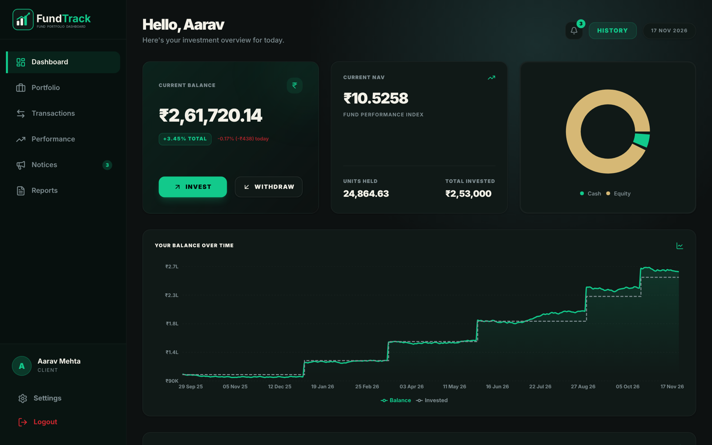
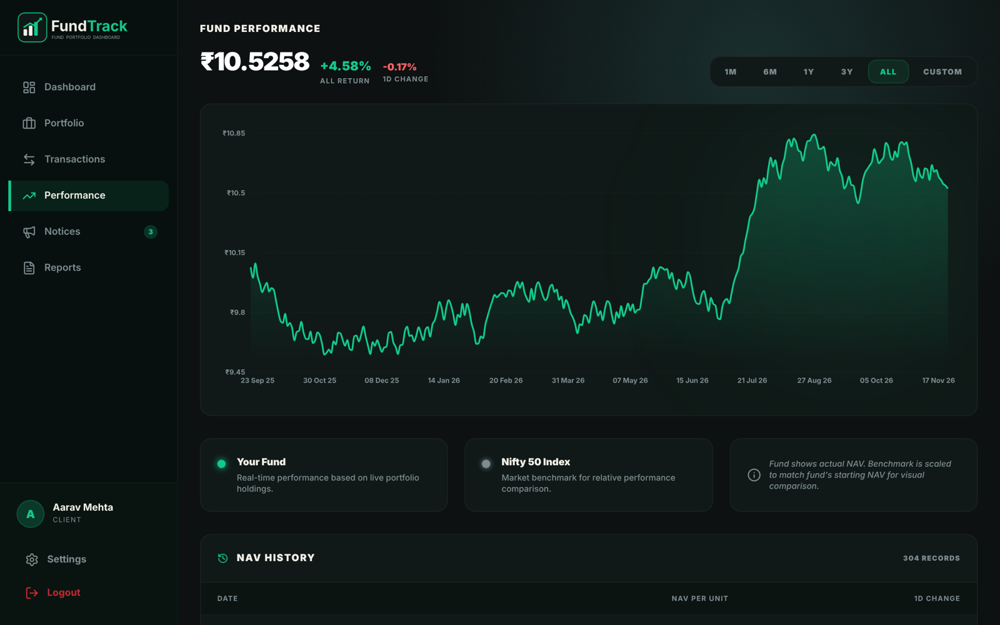
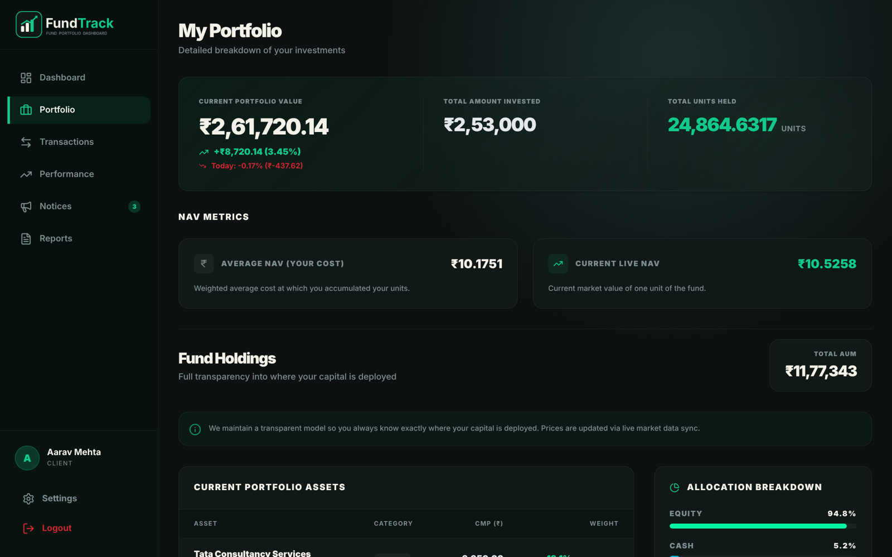
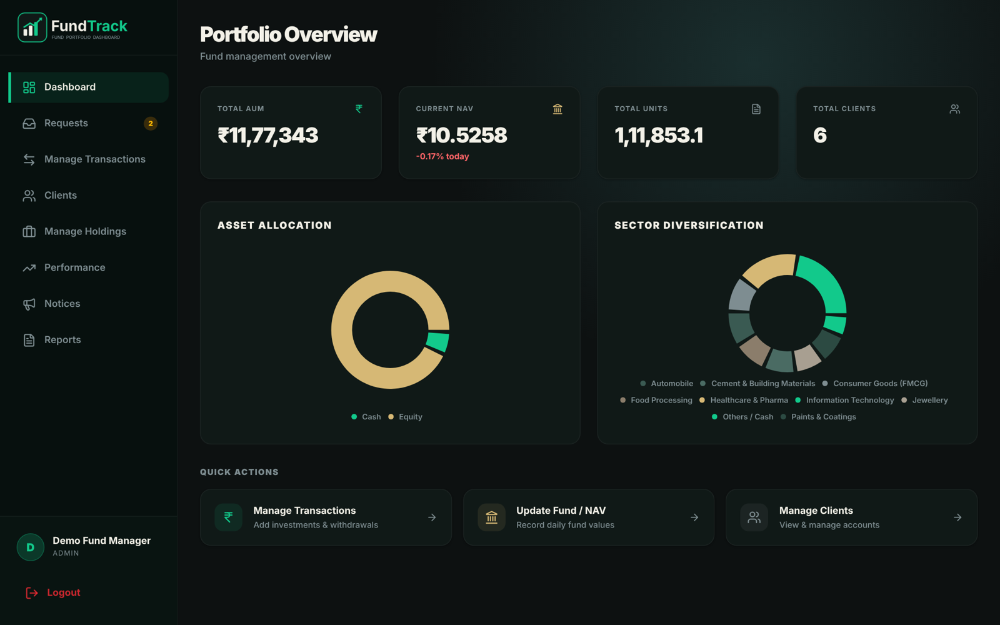
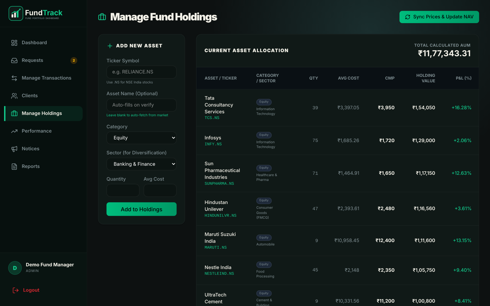
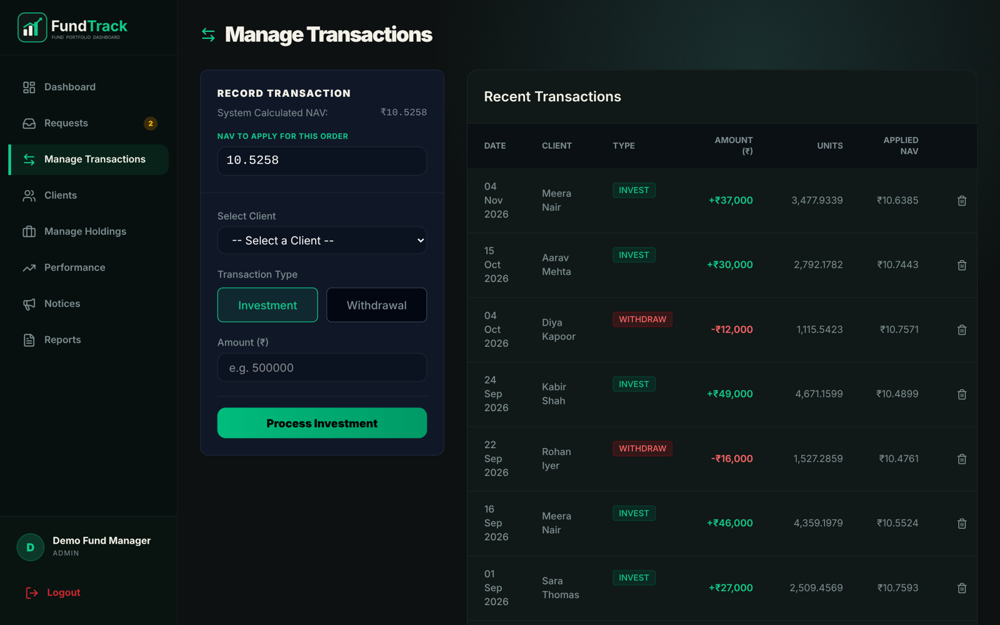
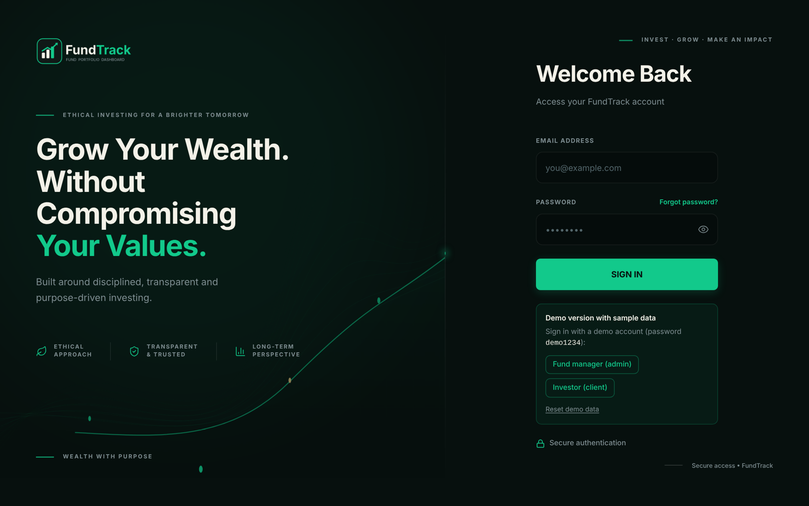

# FundTrack

**A portfolio and NAV dashboard for a small investment fund.** Clients sign in to see what their investment is worth, how the fund is performing and every transaction they've made. The fund manager runs the fund from an admin panel: holdings, prices, NAV, investments, withdrawals, client requests, notices and monthly reports.

> **This repository is a public demo.** It runs entirely in your browser on generated sample data. There is no database, no server-side admin access and no real client information. The production version of FundTrack is used to run a real fund, so its backend is kept in a private repository.



---

## Try it

```bash
git clone https://github.com/izaanebrahim/fundtrack.git
cd fundtrack
npm install
npm run dev
```

Open http://localhost:3000 and pick a demo account on the login page (password `demo1234`):

| Role | Email |
|---|---|
| Fund manager (admin) | `admin@fundtrack.demo` |
| Investor (client) | `investor@fundtrack.demo` |

Anything you change (new transactions, holdings, notices) is saved in your browser's local storage. **Reset demo data** on the login page restores the original sample.

---

## Features

### For investors
- **Dashboard:** current balance, profit and loss, today's NAV change, asset allocation, and a chart of your balance against the amount invested.
- **Portfolio:** units held, average NAV paid, current value, and the fund's full holdings with sector weights.
- **Fund performance:** an interactive NAV chart (1M / 6M / 1Y / all / custom) compared with the Nifty 50, plus the daily NAV history.
- **Transactions:** every investment and withdrawal, with the NAV applied and the units issued or redeemed.
- **Invest and withdraw requests:** ask the fund manager to add money or withdraw it, and follow the request's status.
- **Notices and reports:** updates from the fund manager and downloadable monthly factsheets.
- **Installable app:** works as a home-screen app on phones, with an offline page and pull-to-refresh.

### For the fund manager
- **Overview:** assets under management, live NAV, units in issue, number of clients, and asset and sector allocation.
- **Holdings:** add, edit and remove holdings across 60+ sectors. Ticker symbols are checked against market data before they're added.
- **Price sync and NAV:** refresh prices, recalculate the fund's value and NAV, and record today's NAV.
- **Transactions:** record investments and withdrawals at the current NAV. Units are calculated automatically, and a withdrawal can't exceed what the client holds.
- **Client requests:** see new requests, call, WhatsApp or email the client, and record the transaction from a prefilled form.
- **Clients, notices and reports:** create client logins, post notices and publish monthly reports.

---

## How NAV works

FundTrack uses unit-based accounting, the way mutual funds do.

- **NAV (net asset value per unit)** = total value of all holdings ÷ total units in issue.
- When a client **invests**, they receive `amount ÷ current NAV` units.
- When a client **withdraws**, units are redeemed at the current NAV.
- A client's **balance** = their units × the current NAV.

So every investor gains or loses in proportion to the fund's performance, whenever they joined.

---

## Screenshots

| Fund performance vs Nifty 50 | Portfolio |
|---|---|
|  |  |

| Admin overview | Manage holdings |
|---|---|
|  |  |

| Manage transactions | Login |
|---|---|
|  |  |

---

## Built with

| Layer | Technology |
|---|---|
| Framework | Next.js 16 (App Router) |
| UI | React 19, Tailwind CSS 4, Lucide icons |
| Charts | Recharts |
| Market data | Yahoo Finance (benchmark chart and ticker checks) |
| Dates | date-fns |

## How this demo differs from production

| | Production | This demo |
|---|---|---|
| Data | Hosted database with per-user access rules | Generated sample data in your browser |
| Sign-in | Real accounts and password reset emails | Demo accounts, no emails |
| Admin actions | Server routes with privileged database access | Run in the browser on the sample data |
| Price sync | Live quotes, plus a scheduled daily sync | Small simulated price moves |
| Benchmark chart | Live Nifty 50 data | Live Nifty 50 data |

The pages, components and calculations are the same as in production. The demo data layer is in `src/lib/supabase.js`, `src/lib/demoData.js` and `src/lib/demoApi.js`.

## Project structure

```
src/
├── app/
│   ├── admin/             fund manager pages (overview, holdings, transactions, clients, requests, notices, reports)
│   ├── api/market/        market data routes (benchmark, ticker check)
│   ├── dashboard/         investor dashboard
│   ├── portfolio/         investor portfolio
│   ├── fund-performance/  NAV chart and history
│   ├── transactions/      investor transactions
│   ├── notices/, reports/, settings/, login/
├── components/            charts, sidebar, layout, request form
├── context/AuthContext.js sign-in state and session timeout
└── lib/                   NAV helpers, sectors, demo data layer
```

---

All names, amounts and portfolio figures in this demo are fictional and for illustration only. Nothing here is investment advice.
